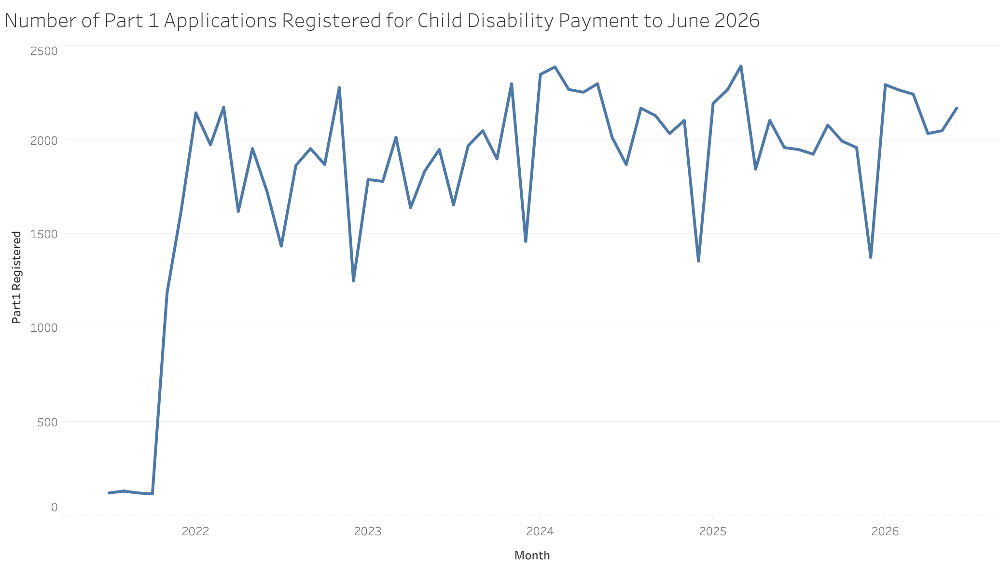

# child-disability-payment-analysis

# Child Disability Payment: SQL Analysis

An independent SQL analysis of publicly available Child Disability Payment
statistics published by Social Security Scotland.

**Data source:** [Child Disability Payment: statistics to 30 June 2026](https://www.socialsecurity.gov.scot/publications/2026/08/child-disability-payment-statistics-to-30-june-2026)

> This is an independent portfolio project. It is not affiliated with, or
> endorsed by, Social Security Scotland. All figures are derived from the
> published open data.

---

## Questions answered

1. How have monthly application volumes changed since the benefit launched
   in July 2021?
2. What proportion of processed applications are authorised, denied, or
   withdrawn?
3. How do yearly totals compare, and what is the year-on-year change?
4. What is the overall decision breakdown across the full period?

## Visualisation



*Monthly applications from July 2021 to June 2026. Chart built in Tableau from the cleaned dataset.*

## Project structure

| File | Purpose |
|------|---------|
| `load_data.sql` | Loads the raw published spreadsheet into DuckDB |
| `clean_data.sql` | Cleans column names, casts types, removes summary rows |
| `queries.sql` | The four analysis queries |
| `applications_clean.csv` | Cleaned dataset (generated by `clean_data.sql`) |

## Tools used

- **DuckDB** — in-process analytical database
- **SQL** — data cleaning, type casting, aggregation, window functions

## How to reproduce

1. Download the data tables from the publication page linked above.
2. Open the relevant sheet in Excel or Numbers and export it as a CSV
   named `CDPJune2026Applications.csv`.
3. Install DuckDB: `curl https://install.duckdb.org | bash`
4. Start DuckDB from the folder containing the CSV:
5. Run the scripts in order:
```sql
.read load_data.sql
.read clean_data.sql
.read queries.sql
